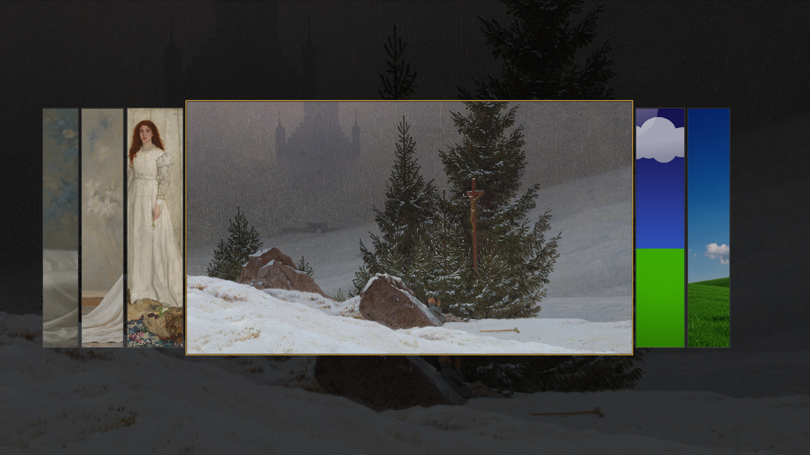

# wallpaper-picker

A standalone wallpaper carousel for Wayland, built with **C++20 + Qt 6** and
launched through a **tcsh** wrapper. It uses the `wlr-layer-shell` protocol via
LayerShellQt, so the same binary works on niri, Hyprland, Sway, Mango, labwc,
and other wlroots-based compositors.



## Features

- Full-screen layer-shell overlay with a dimmed, full-bleed preview.
- Centered active wallpaper shown bare — no frame, no badge, no tint —
  flanked by narrow slices (three per side) that fan out slightly at the bottom.
  Slice width (0.16 of the card) is chosen so both outer slices stay on a
  1920-wide screen.
- Animated geometry on every move (280 ms, cubic ease-out).
- Arrow keys, `hjkl`, mouse wheel, trackpad scroll, side-slice clicks, Enter,
  and Escape. Scrolling is incremental: the wheel/trackpad moves exactly one
  card per 55 px of travel (touchpads step once per ~0.5 cm swipe) instead of
  jumping the whole row on a single event.
- Click the active card or press Enter to apply and close.
- Live preview while browsing; selection is persisted immediately.
- Single-instance toggle: running `wallpaper-picker` again hides/shows the
  existing carousel instead of opening a second one.
- Backend detection for `swaybg`, `hyprpaper`, `awww`, and `swww`.
- CLI mode: `--list`, `--get`, `--set PATH`, `--random`, `--open`, `--toggle`.

## Build

```sh
cmake -S wallpaper-picker -B build/wallpaper-picker -G Ninja -DCMAKE_BUILD_TYPE=Release
cmake --build build/wallpaper-picker
```

Install to your user prefix:

```sh
cmake --install build/wallpaper-picker --prefix "$HOME/.local"
```

This installs:

```text
~/.local/bin/wallpaper-picker
~/.local/lib/wallpaper-picker/wallpaper-picker
```

## Use

```sh
wallpaper-picker                  # toggle the carousel
wallpaper-picker --list           # one image path per line
wallpaper-picker --get            # selected image
wallpaper-picker --set ~/Pictures/foo.jpg
wallpaper-picker --random
```

The tcsh entry point can also run straight from a checkout:

```tcsh
./wallpaper-picker/scripts/wallpaper-picker.csh --list
```

## Compositor bindings

The command is compositor-independent. Examples:

```kdl
// niri
Mod+Shift+B hotkey-overlay-title="Wallpaper" { spawn "wallpaper-picker"; }
```

```ini
# Hyprland
bind = SUPER SHIFT, B, exec, wallpaper-picker
```

```text
# Mango
bind=SUPER+SHIFT,B,spawn,wallpaper-picker
```

```text
# Sway
bindsym $mod+Shift+b exec wallpaper-picker
```

## Configuration

| Variable | Purpose |
| --- | --- |
| `WALLPAPER_PICKER_DIR` | Image directory (default XDG Pictures, non-recursive depth 2). |
| `WALLPAPER_PICKER_STATE` | State JSON path (default `$XDG_STATE_HOME/wallpaper-picker/state.json`). |
| `WALLPAPER_PICKER_BACKEND` | Shell command template used to apply an image; `$1` is the path. |

Backend order when `WALLPAPER_PICKER_BACKEND` is unset:

1. `hyprpaper` when running under Hyprland.
2. `awww` when its daemon is running.
3. `swww` when its daemon is running.
4. `swaybg` as the wlroots common denominator.

The application adopts the current `swaybg -i` image on first run, so the
carousel opens on the wallpaper that is already on screen.

## Why layer-shell?

The overlay is a real layer surface, not a decorated toplevel. It anchors to all
edges, ignores other panels' exclusive zones, and requests keyboard focus only
while visible. Compositors therefore do not tile it or leave it in the window
list. Qt and LayerShellQt are the only toolkit dependencies; the interface is
painted with `QPainter` and image decoding happens off the UI thread.

## Repository layout

```text
wallpaper-picker/
├── CMakeLists.txt
├── preview.png
├── scripts/wallpaper-picker.csh
└── src/main.cpp
```

## License

MIT — use it, fork it, and ship your own rice.
